# Evolution, adaptation, and the scenarios that exercise them

Two files of the engine hold what the modelling assistant can propose:

- [`src/engine/assistant/evolution.ts`](../src/engine/assistant/evolution.ts): the next version of the model of **one DT**, when its data no longer conform to its type (vertical drift, bottom-up).
- [`src/engine/assistant/adaptation.ts`](../src/engine/assistant/adaptation.ts): the **adaptation plan**, the ranked options that bring a correspondence between DTs back (horizontal drift).

The first part of this document describes how the two work. The second part plays every scenario of [scenario-summary.xlsx](scenario-summary.xlsx) in the modeler, with a screenshot per step, and says which part of the mechanism each one exercises.

- [Where the two files sit in the process](#where-the-two-files-sit-in-the-process)
- [evolution.ts](#evolutionts)
- [adaptation.ts](#adaptationts)
- [Paper scenarios](#paper-scenarios): A0, A1, A2, the variant `room2-hidden-count`, timeliness
- [How the screenshots were taken](#how-the-screenshots-were-taken)

## Where the two files sit in the process

[`process.ts`](../src/engine/assistant/process.ts) runs the four steps on a *head* (the committed models) and a *candidate* (what the change would make of them):

```text
trigger ──► 1 change set ──► 2 classified drift ──► 3 impact report ──► 4 adaptation plan ──► modeler decision
                 │                                                          │                      │
       runtime_observation only:                                   AdaptationPlanner.plan()   resolveDecision()
       proposeEvolution() builds                                   (RuleBasedPlanner)         applyOption() on the
       the candidate                                                                           options of the owner
```

| Trigger | How the candidate is built | `evolution.ts` | `adaptation.ts` |
|---|---|---|---|
| `runtime_observation` (a DT reports) | `proposeEvolution(head, changeset)` | proposes the next version | plans on the candidate |
| `model_edit` (the modeler edits, or a woven model has a new version) | the working copy | not used | plans on the candidate |
| `timeliness_violation` | a copy of the head | not used | plans on the candidate |
| change request received by a participating DT | `incomingRequests()` → `proposeForRequest()` | `migrateInstance()` | builds the proposal |

Both files only build candidates and options. Nothing is committed without a modeler decision, and a decision only applies the options of the correspondences its own model owns (`resolveDecision` skips the others).

## evolution.ts

### `proposeEvolution(head, changeset)` → `[candidate, proposal | null]`

Answers a bottom-up change: the DT reports capabilities that differ from what its model binds.

1. **Record what the DT reports.** For every change at the data level, a removed or modified key is *lost* and leaves the capabilities of the DT; an added or modified key is *fresh* and enters them. This is always done.
2. **Stop when nothing bound is lost.** If no lost key is bound to an attribute of the instance, there is no proposal: a new key alone is a capability nobody uses yet.
3. **Next version of the type.** The O1 model is cloned with the next version number. The attribute bound to each lost key is removed; a class left with no attribute is removed too.
4. **A class for each fresh key.** Its name is the hint `observation` of the capability, or the key in CamelCase. It is an instance of the same O2 concept as the class that was removed, and it inherits its references and properties. Its attribute takes type, unit and meaning from the capability. When the capability carries the hint `source`, the class the removed one referred to is replaced by one with that name, unless something else still uses it.
5. **What replaced what.** Removed and added classes are paired in order (`Occupancy -> PeopleCount`), then the replaced sources (`Presence -> PeopleCounter`).
6. **Sensors that are gone.** A sensor all of whose bound keys are lost is removed, with its class when no other sensor of that kind is left.
7. **The instance follows**, with `migrateInstance` (below).
8. **Parts of a device.** A fresh key provided by a part that is attached and not in the model (`capability.part`) adds the part as a sensor and an observation for every parameter it senses. Observations left without data are paired with the new ones, sensors that are gone with the parts that came (`MotionDetectorV2 -> Nfc`), and references to a replaced class are re-pointed.
9. **The trace.** `linkVersions` writes the evolution weaving model (`ev-<type>-<from>-<to>`): one link for the version, one per replaced class, one per class that is kept. The planner follows this trace to find the successor of an element another DT depends on.

The result is an `EvolutionProposal` (`package`, `instance`, `fromVersion`, `toVersion`, `replaces`), shown in the app as *Proposed evolution: room1 v1 → v2 (Occupancy -> PeopleCount, Presence -> PeopleCounter)*.

### `migrateInstance(fed, instance, targetKey)`

Retypes an O0 model to a version of its type, in place.

- An object whose class survives is kept, without the bindings and slots the class no longer has.
- A class without an object gets one, named in snake_case. If its concept requires a source of data, every attribute is bound to a capability of the DT with the same type and unit, and the same meaning when both declare one: the key of the same name, or else the only one that fits. If none fits, `EvolutionError`.
- A mandatory reference whose target is gone is re-pointed when exactly one object of the right class exists; otherwise it is left open, for the gate to point out and the modeler to settle.

There is no value coercion anywhere in this: a key backs an attribute only if type, unit and meaning agree.

## adaptation.ts

### The plan as data

An `AdaptationPlan` has one `Resolution` per drifted correspondence (`drift`, `owner`, `element`, `correspondence`), each with ranked `Option`s, and the `interim` behaviour of what is affected until the plan is committed. An option is data: `kind`, `params`, `automatic`, and the `changes` it would make. `applyOption` turns it into model changes, so a plan can be stored, inspected and applied later.

| Kind | What `applyOption` does | When it is proposed |
|---|---|---|
| `adapt` (automatic) | re-targets the correspondence to another participating element, without a mapping | the element that can provide the value has the same meaning, type and unit |
| `derive` | re-targets and writes a `mapping` in the correspondence | the meanings differ and `core` admits a derivation between them whose result has the expected type |
| `adapt` · *needs the modeler* | nothing: `applyOption` refuses it | always, for a broken correspondence: the initiating DT consumes the new element itself, with a new type version and its dependents revised |
| `change_request` | marks the correspondence `pending`, with the request and the interim behaviours | no automatic option is left |

Re-targeting (`retarget`) sets the participating end, rewrites what the correspondence expects (type version, type, unit, meaning) from the new element, sets or removes the mapping and clears `status`, `changeRequest` and `interim`.

### `RuleBasedPlanner.plan(context)`

For every horizontal drift of the classified drift:

1. **Generate.**
   - Status *broken* → `deriveBroken`: the successor of the participating element is found through the evolution trace (`successorElement`), then `derivation` compares it with the initiating element. Same meaning, type and unit: `adapt`. Different meanings: the rule `from → to` of the derivations of `core` is looked up, its expression is typed on the source, and if the result has the expected type the option is `derive`, with `value` renamed to the attribute (`value > 0` becomes `count > 0`). The non-automatic `adapt` is always added, listing the dependents the modeler would revise.
   - Status *missing* → `provide`: every attribute of every object of the participating DT is tried with the same `derivation`.
2. **Verify.** Each automatic proposal is applied to the candidate and the correspondences are checked again: the option is kept only if its own correspondence then holds (or is pending) and no correspondence that was settled breaks. The diff becomes `option.changes`.
3. **Fall back.** If no automatic option is kept, a `change_request` is added: *restore … as expected by …* for a broken correspondence, *model the observation key … that the DT already provides* or *new data source in …* for a missing one, depending on what the DT reports (`providingKey`).
4. **Rank.** Options are lettered `a`, `b`, … in that order: from the least to the most invasive.

After that, every correspondence that is already `pending` is tried again with `provide`: a change request is closed as soon as the participating DT models what was asked for.

`interim` comes from the impact report: each *dependency* entry gives an element and its behaviour (`exclude input`, `suspend`) until the plan is committed. A change request carries the interim behaviours of what it reaches in the impact graph.

### The other side of a change request

`incomingRequests(fed, model)` lists the requests other DTs have open on a model. When the DT already reports data that fit and its type has no attribute for them, `proposeForRequest` builds the next version: the class that models those data in another DT is copied, with the classes it refers to, and `migrateInstance` instantiates it on the reported key.

### What each scenario exercises

| Scenario | `evolution.ts` | `adaptation.ts` |
|---|---|---|
| A1 · Room 1 | `proposeEvolution`: steps 1 to 7 and 9 | `deriveBroken` → `derive`, `adapt` (modeler) |
| A1 · Building | – | `deriveBroken`, `applyOption(derive)` |
| A1 on a device | `proposeEvolution` with parts (step 8) | as A1 |
| A2 · Building | – | `provide` finds nothing → `change_request` |
| A2 · variant | `migrateInstance` | `proposeForRequest`; `provide` on the pending request → `adapt` |
| Timeliness | – | `deriveBroken` finds no successor → `change_request` |

---

## Paper scenarios

The scenarios of [`init/SPEC.md`](../init/SPEC.md) section 6, on the models of [`scenarios/building`](../scenarios/building): two participating DTs (`room1`, `room2`), one initiating DT (`building`), the shared concepts in `core`. In the screenshots the diagram is on the left and the *Process* tab on the right, with the four steps and the modeler decision.

### A0 · Baseline

Version 1 of every model. `building` weaves `room1` and `room2` through `c-r1-occupancy` and `c-r2-occupancy`: both sides mean *occupancy*, as a Boolean, and both correspondences hold. There is nothing to process.

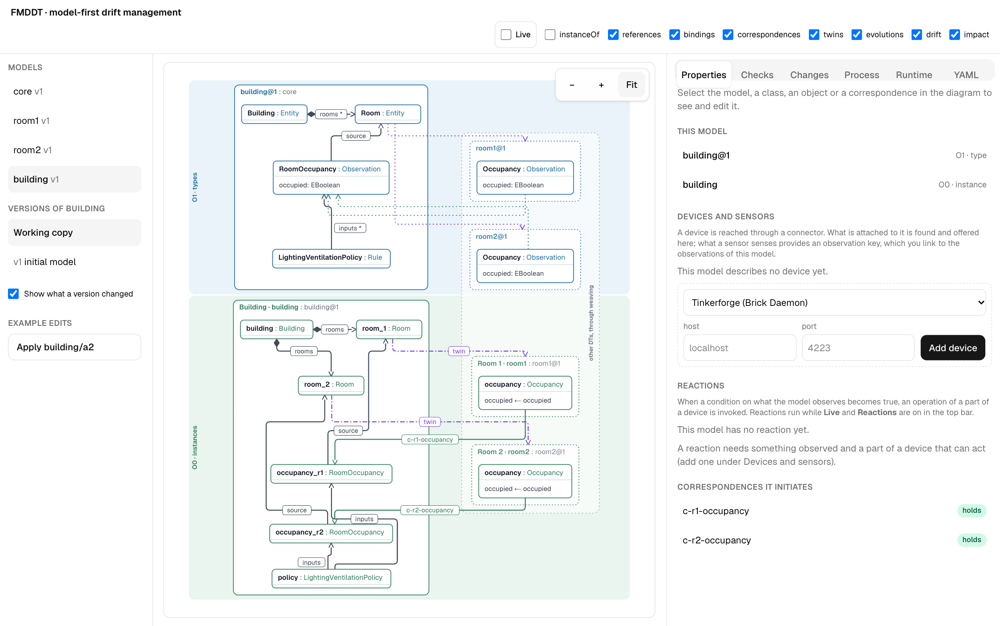

### A1 · A participating DT evolves (Room 1)

**Do.** `room1` → *Runtime* → *Report from a DT* → `building/a1/observations.yaml` → **Send to the modeling layer**.

Room 1 now reports `count` (EInt, person, people-count) and no longer `occupied`. Nobody edited a model.

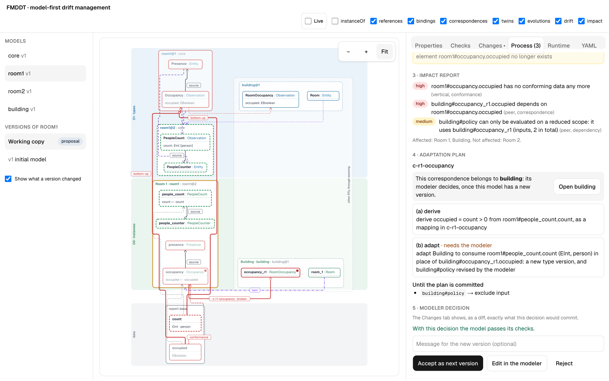

| Step | Result |
|---|---|
| Change set | `runtime_observation`, origin Room 1, level data: `occupied` removed, `count` added. |
| Classified drift | Vertical, bottom-up, twice: the bound key is no longer provided; no element accounts for the new key. Horizontal, broken, `c-r1-occupancy`: the participating element no longer exists. |
| Impact report | `room1#occupancy.occupied`: conformance, high. `building#occupancy_r1.occupied`: correspondence, high. `building#policy`: dependency, medium (reduced scope). |
| Adaptation plan | For `building` to decide: (a) derive `occupied = count > 0`; (b) adapt Building to consume the count. Interim: `building#policy` excludes the input. |

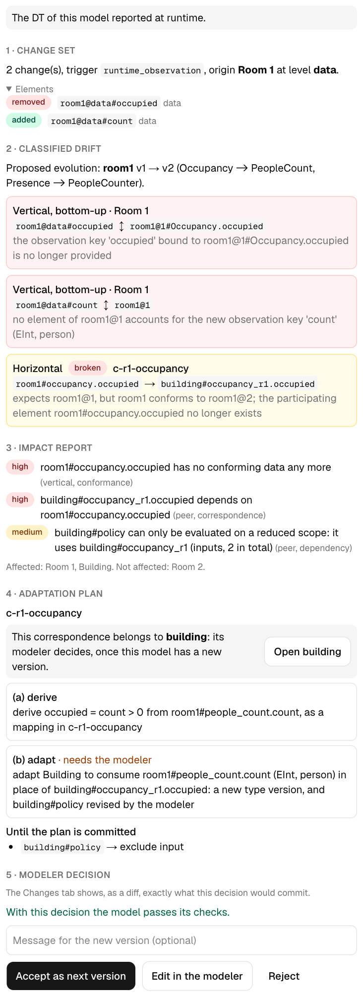

**Mechanism.** `proposeEvolution` loses the bound key `occupied`, removes `Occupancy`, adds `PeopleCount` (hint `observation`) with the source `PeopleCounter` (hint `source`), migrates the instance and writes the trace `Occupancy -> PeopleCount`, `Presence -> PeopleCounter`. The planner follows that trace from `room1#occupancy.occupied` to `room1#people_count.count`; the meanings differ, `core` admits `people-count → occupancy` as `value > 0`, so the first option is `derive`. The correspondence belongs to `building`: Room 1 sees the plan and cannot decide it.

*Changes* shows what accepting would commit, as a model diff:

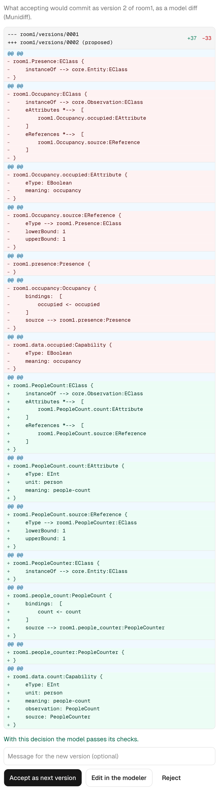

**Outcome.** Room 1 accepts: `room1` version 2. Building is then in drift.

### A1 · The initiating DT follows (Building)

**Do.** Open `building`: it carries the mark *drift*, and *Process* opens on *A model this one weaves has a new version*.

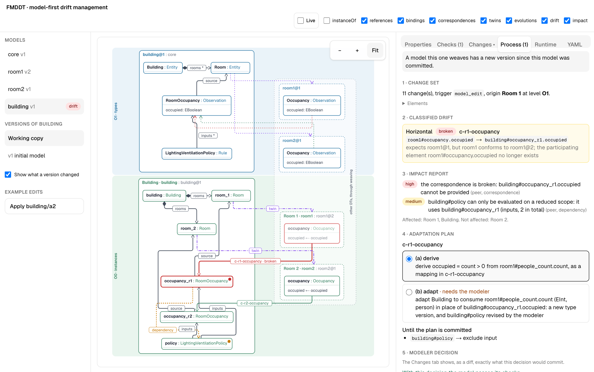

The same horizontal drift, now in the model that owns the correspondence: the options have a radio button, and (a) is selected.

**Outcome.** Building accepts (a): `building` version 2. `applyOption` re-targets `c-r1-occupancy` to `room1#people_count.count` and writes the mapping `count > 0` in it. Both correspondences hold; `room1` is not touched.

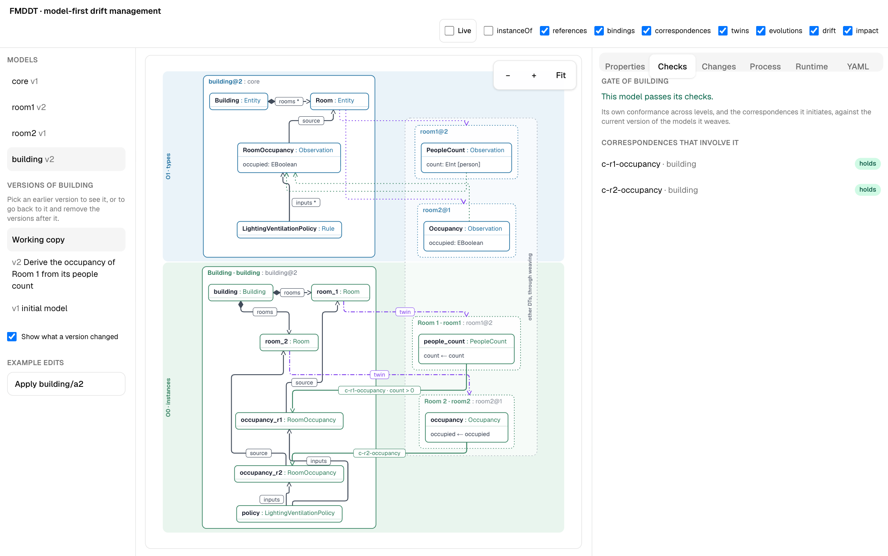

### A1 on a device (Room 1)

The same scenario with a device in the model, where the lost key and the new one come from parts of the device, is the acceptance test [`tests/a1-devices.test.ts`](../tests/a1-devices.test.ts).

### A2 · The initiating DT evolves (Building)

**Do.** `building` → **Apply building/a2**.

Building now needs the number of people in each room: a new class `RoomCount`, the indicator `TotalPeople`, the goal `SafetyGoal`, and two correspondences, `c-r1-count` and `c-r2-count`.

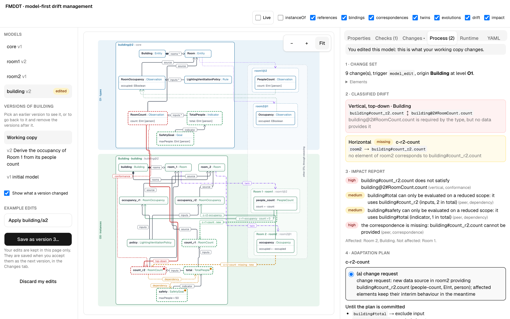

| Step | Result |
|---|---|
| Change set | `model_edit`, origin Building, level O1. |
| Classified drift | Vertical, top-down, Building: `RoomCount.count` is required by the type, but no data provide it for Room 2. Horizontal, missing, `c-r2-count`: no element of `room2` corresponds. |
| Impact report | `building#count_r2.count`: conformance, high; correspondence, high. `building#total`, `building#safety`: dependency, medium (reduced scope). |
| Adaptation plan | `c-r2-count`: (a) change request, a new data source in `room2`. Interim: `building#total` and `building#safety` exclude the input. |

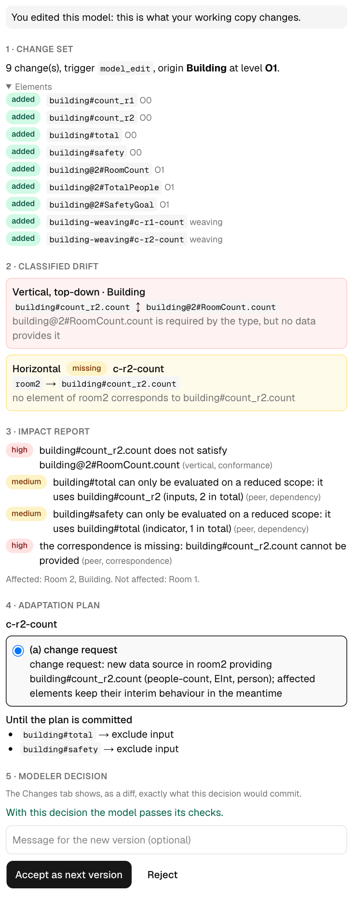

**Mechanism.** `c-r1-count` raises nothing: Room 1 already models a count. For `c-r2-count` the status is *missing*, so the planner runs `provide`: no attribute of `room2` has the meaning *people-count* or one from which it can be derived (a count tells whether a room is occupied, never the opposite). No automatic option is left, and the plan falls back to a change request.

**Outcome.** Building accepts: `building` version 3. `c-r1-count` holds, `c-r2-count` is pending.

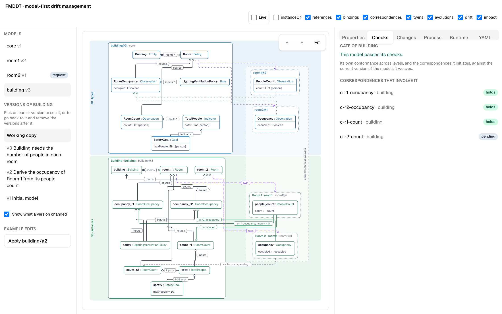

`room2` carries the mark *request*. Its DT reports nothing that fits, so there is no proposal: the new data source is for its modeler to model.

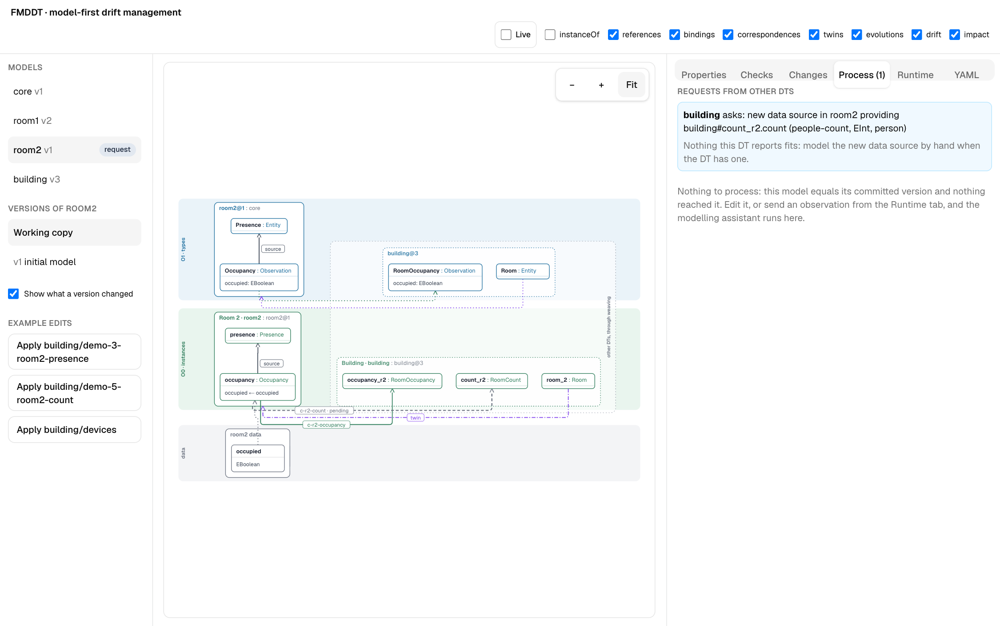

### A2 · Variant `room2-hidden-count` (Room 2, then Building)

The same scenario started from **Start from building (room2-hidden-count)**: the DT of Room 2 already reports a `count`, which its model does not use. The change request then reads *model the observation key 'count' that room2 already provides*.

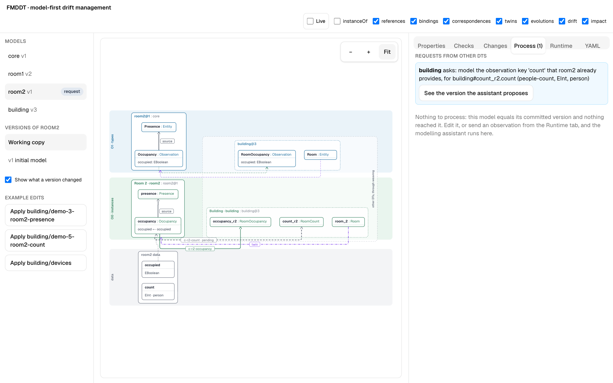

**Do.** `room2` → *Process* → **See the version the assistant proposes**.

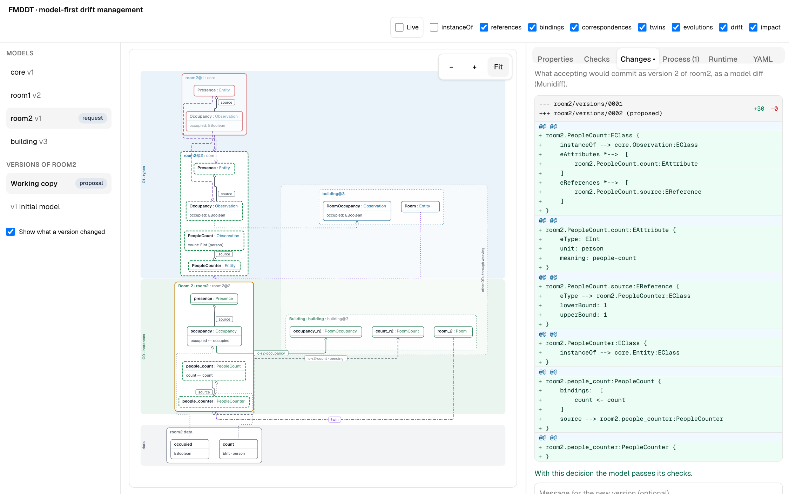

**Mechanism.** `proposeForRequest` finds that the DT has a capability for what Building needs (`providingKey`), copies `PeopleCount` and `PeopleCounter` from the current type of `room1`, and `migrateInstance` binds the new object to the key `count`. No drift: nothing Room 2 offered has changed.

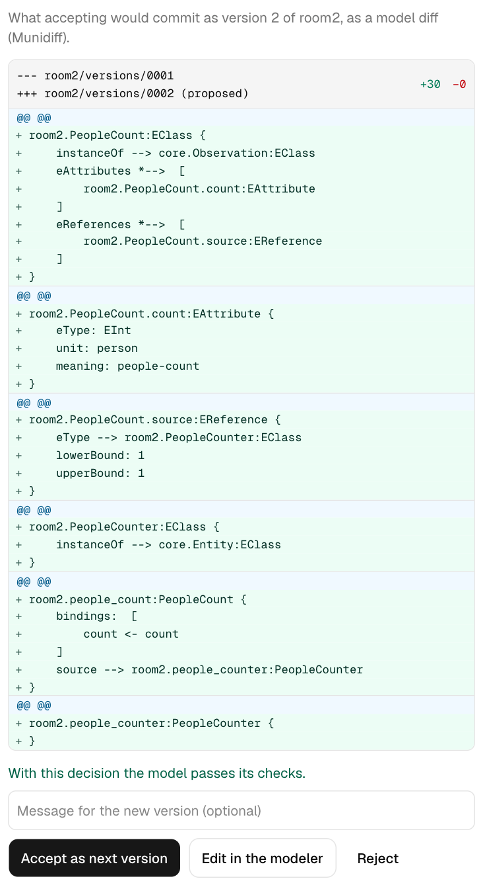

**Outcome.** Room 2 accepts: `room2` version 2. In `building`, the pending correspondence is tried again with `provide`, which now finds `room2#people_count.count` with the same meaning, type and unit: the option is `adapt`, without a mapping.

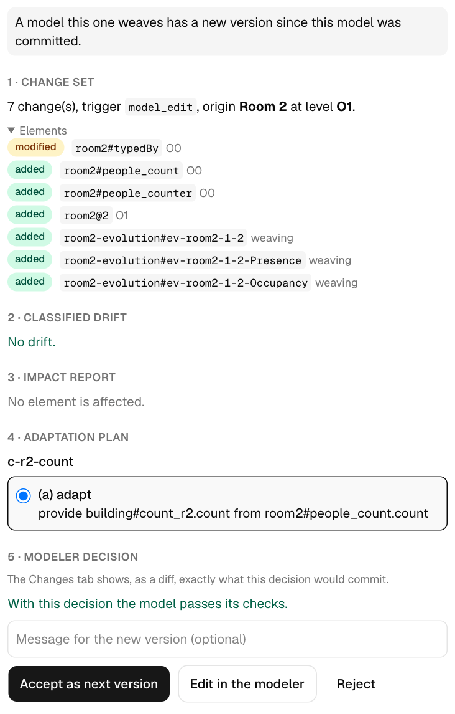

Building accepts: `building` version 4, all four correspondences hold.

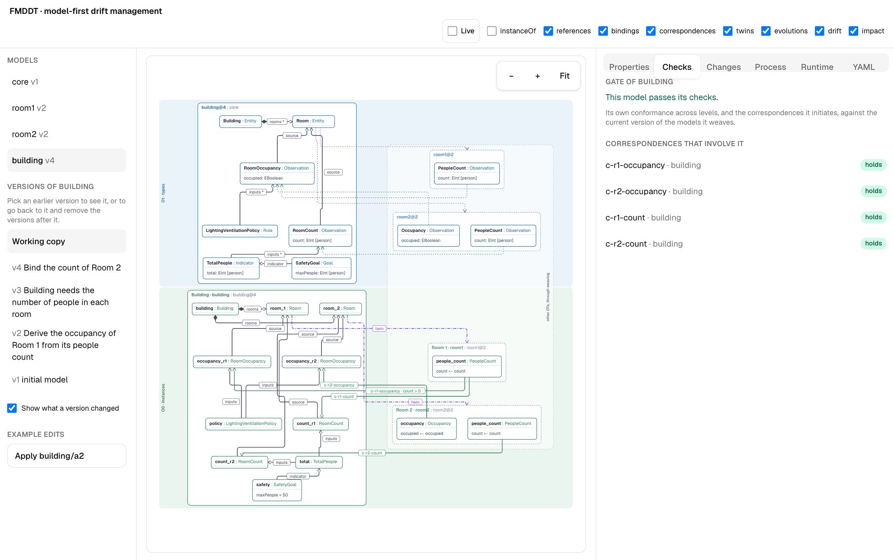

### Timeliness

Played after the variant. `c-r2-occupancy` and `c-r2-count` expect observations no older than 60 s.

**Do.** *Runtime*: Room 2 emits `occupied = true`, `count = 1` at t = 20; Room 1 emits `count = 3` at t = 100; set the current time to 110 and press **Check timeliness**.

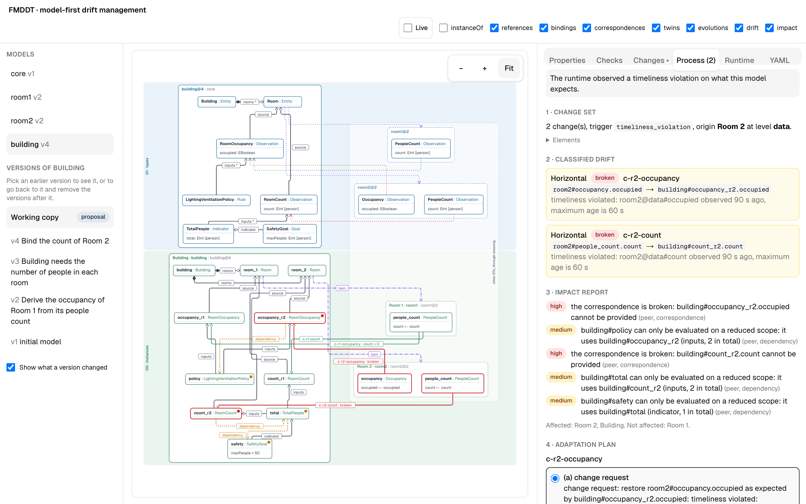

| Step | Result |
|---|---|
| Change set | `timeliness_violation`, origin Room 2, level data. |
| Classified drift | No vertical drift. Horizontal, broken, `c-r2-occupancy` and `c-r2-count`: observed 90 s ago, maximum age is 60 s. |
| Impact report | Both elements of Building: correspondence, high. `building#policy`, `building#total`, `building#safety`: dependency, medium (reduced scope). |
| Adaptation plan | On each correspondence: (a) change request, restore the element as expected. Interim: the three dependents exclude the input. |

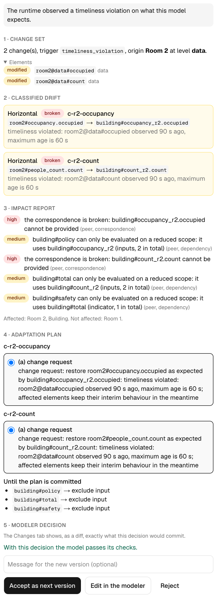

**Mechanism.** No model changed, so the evolution trace has no successor for the elements of Room 2 and `deriveBroken` proposes nothing: a late value cannot be derived from anything in the models. Only the change request is left.

**Outcome.** Building accepts: `building` version 5, both correspondences pending, Room 2 not changed. The runtime, regenerated from the models, evaluates the policy, the total and the goal on a reduced scope.

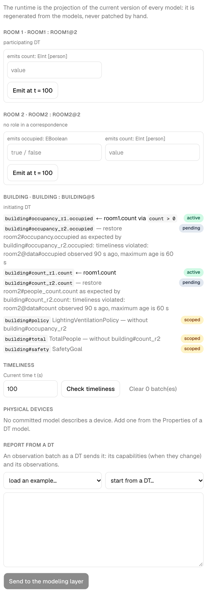

---

## How the screenshots were taken

On 2026-11-14, at commit `748fa19`, by driving the modeler in a headless browser against two fresh model repositories (`FMDDT_REPO` set to an empty folder, then *Start from building*):

1. the scenario as shipped: A0, A1, A2;
2. the variant `room2-hidden-count`: A1 and A2 again, then Room 2, the binding and timeliness;

Wide images are the whole window; narrow ones are the tab on the right alone, at its full height and with the *Elements* of the change set unfolded. The path of the repository in the top bar is hidden. Nothing else was altered.

The texts of the engine in the tables are shortened. The screenshots and [scenario-summary.xlsx](scenario-summary.xlsx) have them in full.
