# The walk: induce a drift and resolve it, step by step

A walk from the first version of every model to a federation that has drifted and been brought back, one decision at a time. It needs no hardware: the rooms sense through **simulated devices**. Every step is an edit or a report shipped next to the scenario, in `scenarios/building/walk-*`, and the whole walk is the acceptance test [`tests/walk.test.ts`](../tests/walk.test.ts).

Each step has three parts: **Do**, what to click; **You see**, what the app answers; **Why**, what that is in the terms of the paper. Texts in quotes are the reasons the engine gives.

## Overview

| Step | Model in focus | Drift | Outcome |
|---|---|---|---|
| 1 · Presence sensor | room1 | none | room1 version 2 |
| 2 · Indicator light | room1 | none | room1 version 3 |
| 3 · Presence sensor | room2 | none | room2 version 2 |
| 4 · From the data (optional) | room1 | **vertical, bottom-up**, and horizontal | rejected: room1 stays at version 3 |
| 4a · The type alone | room1 | **vertical, top-down**, and horizontal | cannot be committed |
| 4b · The instance follows | room1 | **horizontal** on `c-r1-occupancy` | room1 version 4 |
| 5a · The data change | room2 | **vertical, bottom-up**, and horizontal | rejected: room2 stays at version 2 |
| 5b · The model follows | room2 | **horizontal** on `c-r2-occupancy` | room2 version 3 |
| 6 · Building decides | building | resolved | building version 2, both correspondences hold |

Step 4 is the bottom-up variant of steps 4a and 4b: the same change of Room 1, learned from the data instead of made in the type.

## Before you start

```sh
npm ci
FMDDT_REPO=/tmp/fmddt-walk npm run dev      # http://localhost:3000
```

- On the empty folder the app offers **Start from building**: version 1 of `core`, `room1`, `room2` and `building`. Building, the initiating DT, has the correspondences `c-r1-occupancy` and `c-r2-occupancy`: it expects from each room a Boolean `occupied` that means *occupancy*.
- Take the steps in order. An edit replaces the type and the instance of its model in the *working copy*; nothing is written to the model repository until you accept.
- **To apply an edit**: open the model, then **Apply building/walk-…** under *Example edits*, on the left.
- **To save a step**: *Process*, scroll to *5 · Modeler decision*, write a message, **Accept as next version**.
- Where to look: **Changes** is the diff the version would commit, **Process** is the four steps of the modelling assistant, **Checks** is the gate.
- To walk again, start from another empty folder.

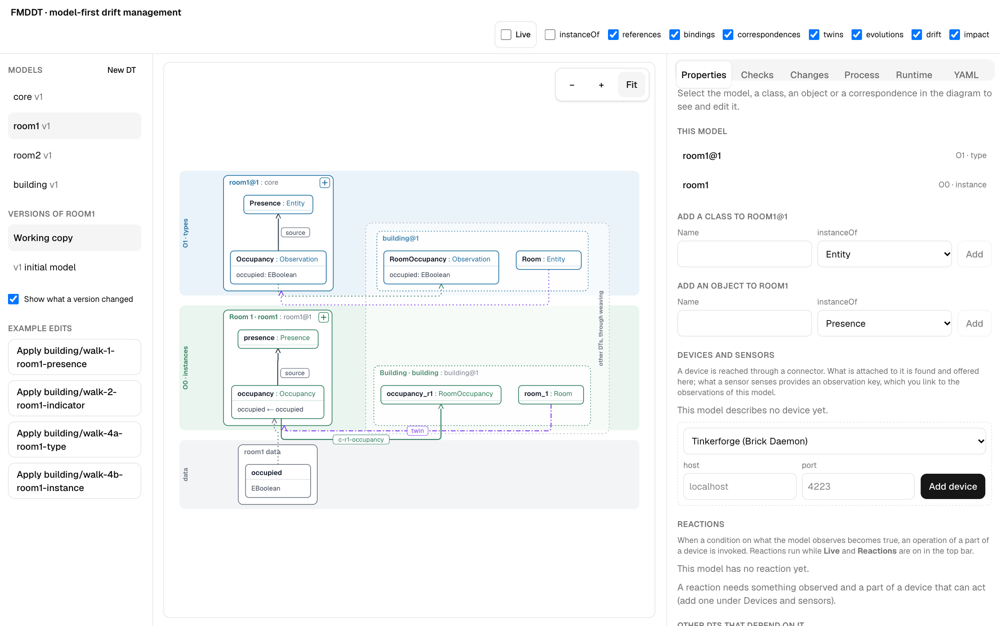

## Steps 1, 2, 3 · A room changes how it senses

**Do.**

1. Open `room1`. **Apply building/walk-1-room1-presence**. Save.
2. Still in `room1`: **Apply building/walk-2-room1-indicator**. Save.
3. Open `room2`. **Apply building/walk-3-room2-presence**. Save.

**You see.** In step 1, a `SimulatedDevice` and a `PresenceSensor` in the diagram, and `occupancy.occupied ← detected`. In step 2, a `Switch` (an indicator light) and two `Reaction` objects: `occupied` switches the light on, `not occupied` switches it off. In step 3, the same sensor in Room 2. Every time, *Process* says *No drift*, and `building` carries no *drift* mark.

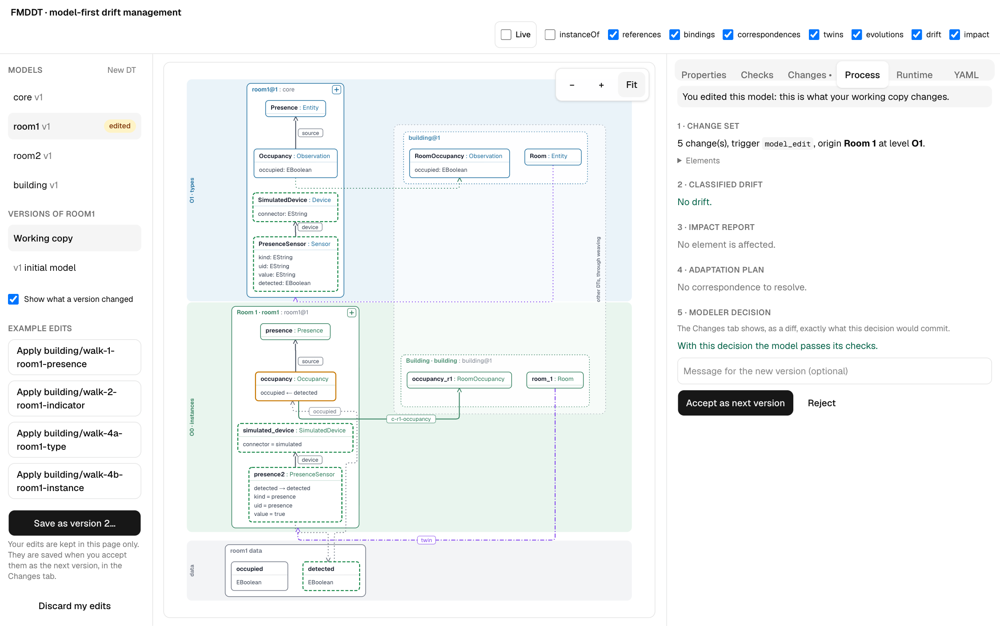

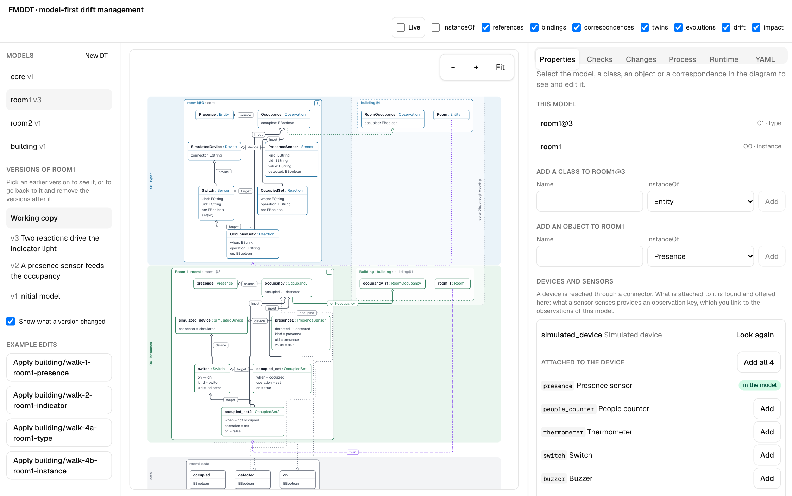

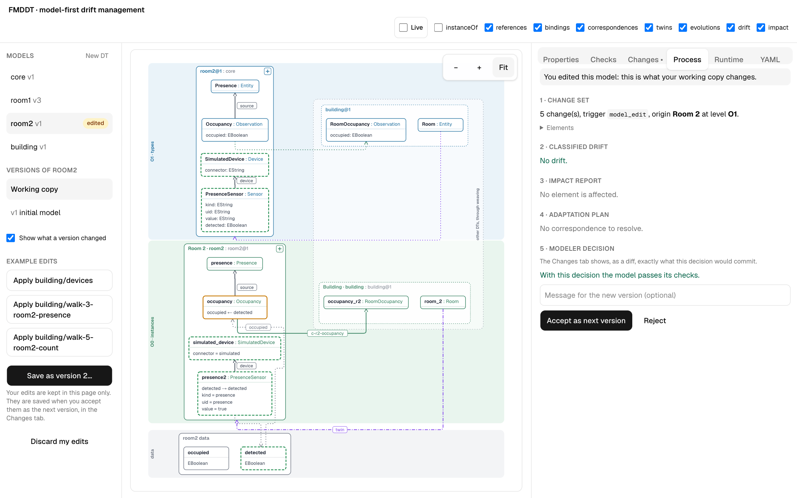

**Why.** A room changed how it senses, not what it offers. Building uses `room1#occupancy.occupied`, which is still a Boolean that means *occupancy*. A new version of a participating DT is not drift in itself: after three versions of the rooms, Building is still at version 1 and nothing asks it to move.

## Step 4 · The same change, seen from the data (optional)

**Do.** Open `room1`. **Runtime** → *Report from a DT* → *load an example…* → `building/walk-4-room1-from-data/observations.yaml` → **Send to the modeling layer**. Open *Process*. Do not accept.

**You see.** Trigger `runtime_observation`, origin Room 1, level *data*: the key `detected` is gone, the key `count` is new.

- **Vertical, bottom-up · Room 1**: "the observation key 'detected' bound to room1@3#Occupancy.occupied is no longer provided".
- **Vertical, bottom-up · Room 1**: "no element of room1@3 accounts for the new observation key 'count' (EInt, person)".
- **Horizontal, broken, `c-r1-occupancy`**: "the participating element room1#occupancy.occupied no longer exists".

The assistant proposes the next version of `room1` on its own: `Occupancy -> Count`, `PresenceSensor -> PeopleCounter`. The impact report suspends the two reactions and leaves `building#policy` *on a reduced scope*. The plan, for Building to decide: **(a) derive** `occupied = count > 0`, or **(b) adapt** Building to consume the count.

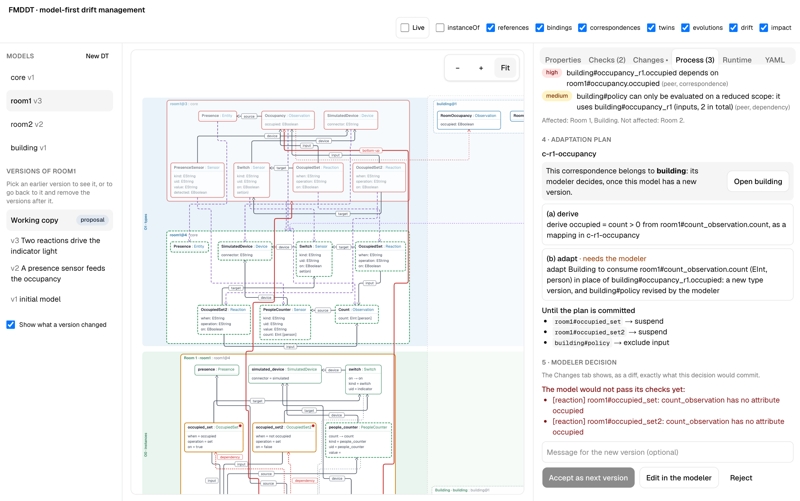

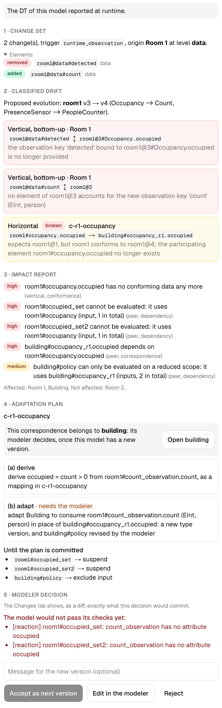

The proposal does not pass its checks: the reactions it carried over read `occupied`, which the new observation does not have. **Accept as next version** is disabled.

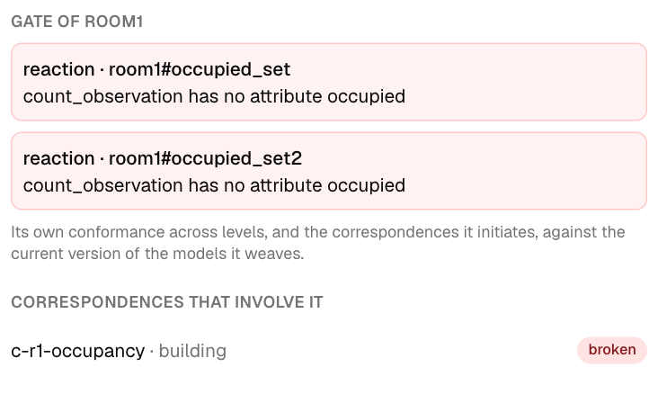

**Why.** Nobody edited the model: the presence sensor stopped answering, a people counter is attached, and the modeling layer learned it from what the DT reports. Vertical drift is an inconsistency across the levels of one DT; here it starts at the data and reaches the type: bottom-up. It is a drift only because the Boolean no longer arrives. While the sensor still answers, the data match the model, and which sensor feeds the occupancy is a decision of the modeler: steps 4a and 4b.

**Then.** Press **Reject**. Room 1 stays at version 3.

## Step 4a · The type of Room 1 changes, alone

**Do.** Open `room1`. **Apply building/walk-4a-room1-type**. Do not save: look.

**You see.** In the type, `Occupancy.occupied` is now `EInt`, unit `person`, meaning `people-count`, and there is a class `PeopleCounter`. The instance is as it was.

- **Vertical, top-down · Room 1**: "key 'detected' provides EBoolean, the type expects EInt".
- **Horizontal, broken, `c-r1-occupancy`**: "expects eType EBoolean, but room1#occupancy.occupied has EInt; expects meaning occupancy, but room1#occupancy.occupied has people-count; …".

The diagram draws the vertical link in red between the type and the instance.

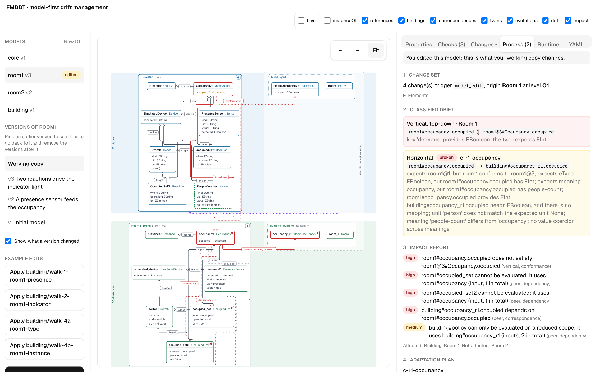

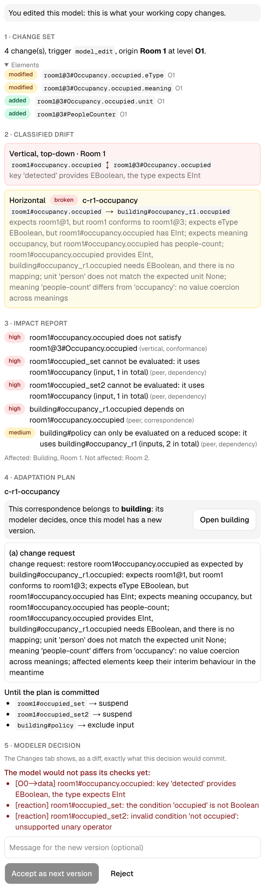

At the end of *Process*: *The model would not pass its checks yet*, and **Accept as next version** is disabled. *Checks* gives the reasons: the bound key provides a Boolean, and the conditions of the two reactions are no longer Boolean.

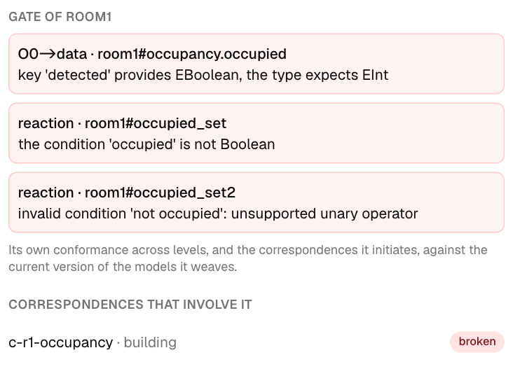

**Why.** The drift starts at the type (O1) and reaches the instance and its data (O0), which do not follow yet: top-down. The model-first rule holds: a model that does not conform to itself cannot be committed.

## Step 4b · The instance follows

**Do.** Still in `room1`, without discarding: **Apply building/walk-4b-room1-instance**. Save.

**You see.** A `people_counter` part, `occupancy.occupied ← count`, the reactions on `occupied > 0` and `occupied == 0`. The occupancy is still an observation of `presence`: no concept of the model was replaced. In *Process* the vertical drift is gone; the horizontal one stays, with the same reasons as in 4a. The plan for Building lists only a change request (*restore room1#occupancy.occupied as expected by Building*), and until it is committed `building#policy` *excludes the input*. *Checks* of `room1` is green, so the version can be saved. After saving, `building` carries the mark **drift**.

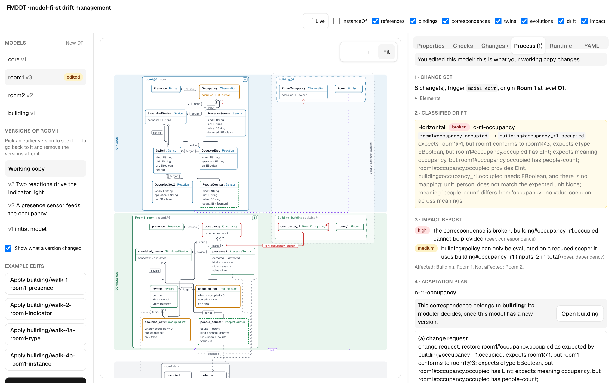

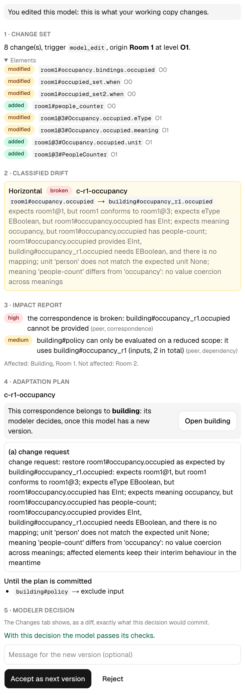

**Why.** Room 1 is consistent again, and it is entitled to its own version: a model is committed alone, by its own modeler. What it offers has changed meaning, though, and Building still expects a Boolean. That is horizontal drift, and it belongs to Building to resolve. Until then the policy excludes the input: `occupied = 3` is never read as `true`.

## Step 5a · Room 2 reports something else

**Do.** Open `room2`. **Runtime** → *Report from a DT* → *load an example…* → `building/walk-5-room2-count/observations.yaml` → **Send to the modeling layer**. Open *Process*. Do not accept.

**You see.** Trigger `runtime_observation`, origin Room 2.

- **Vertical, bottom-up · Room 2**: "the observation key 'detected' bound to room2@2#Occupancy.occupied is no longer provided".
- **Vertical, bottom-up · Room 2**: "no element of room2@2 accounts for the new observation key 'count' (EInt, person)".
- **Horizontal, broken, `c-r2-occupancy`**, and `c-r1-occupancy`, broken since step 4b.

The assistant proposes a next version of `room2`: `Occupancy -> Count`.

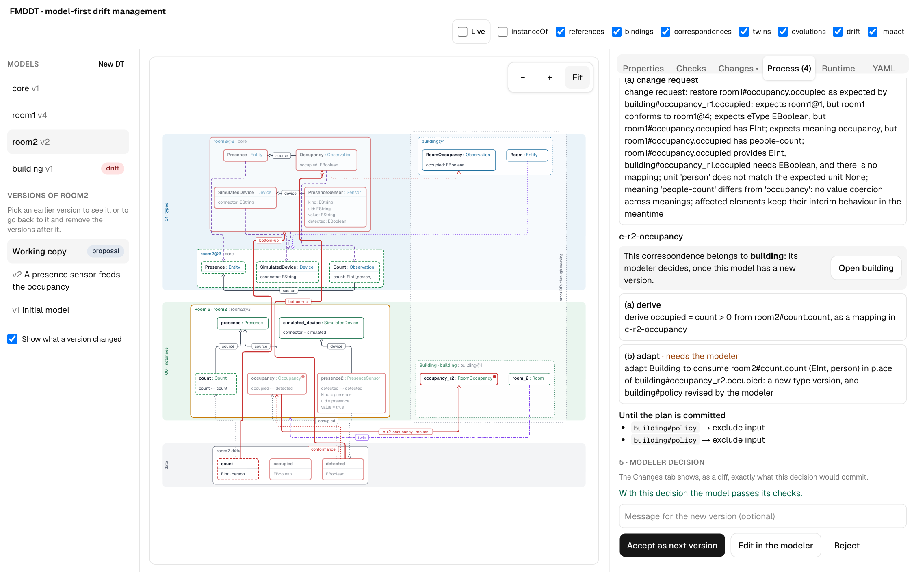

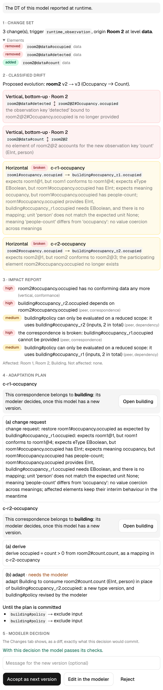

**Why.** The same kind of inconsistency as in 4a, from the other end: the data changed and the model no longer describes them.

**Then.** Press **Reject**. The assistant's version would rename the observation; step 5b keeps the name `occupied`, so that both rooms drift the same way.

## Step 5b · The model of Room 2 follows its data

**Do.** In `room2`: **Apply building/walk-5-room2-count**. Save.

**You see.** A `PeopleCounter` part; `occupancy.occupied ← count`, now `EInt`, `person`, `people-count`. No vertical drift. *Process* lists the horizontal drift on `c-r2-occupancy`, with the same reasons as Room 1. `building` is in drift on both correspondences.

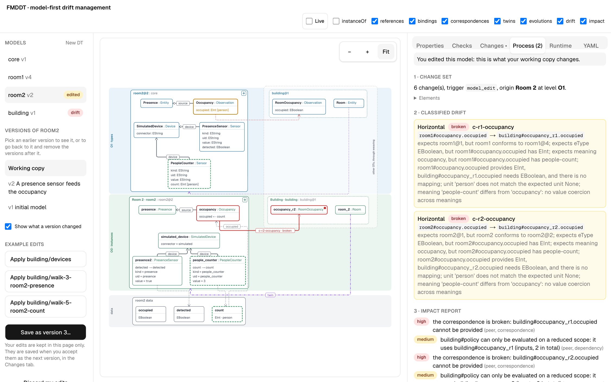

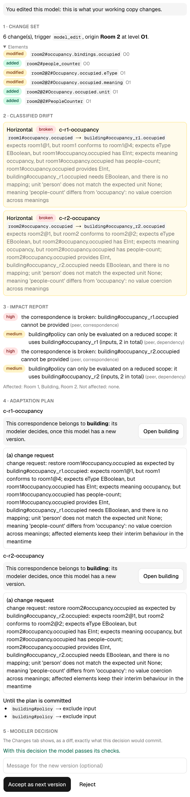

**Why.** The vertical drift is resolved in the DT where it arose. What is left is, again, a matter between DTs.

## Step 6 · Building decides

**Do.** Open `building`. *Process* opens on *A model this one weaves, or the shared concepts, has a new version since this model was committed*. In step 4, for `c-r1-occupancy` and `c-r2-occupancy`, keep **(a) derive**. Write a message. **Accept as next version**.

**You see.** For each correspondence, two options: **(a) derive** `occupied = occupied > 0` from the occupancy of the room, as a mapping in the correspondence; **(b) adapt** Building to consume the count, with a new type version and `building#policy` revised by the modeler.

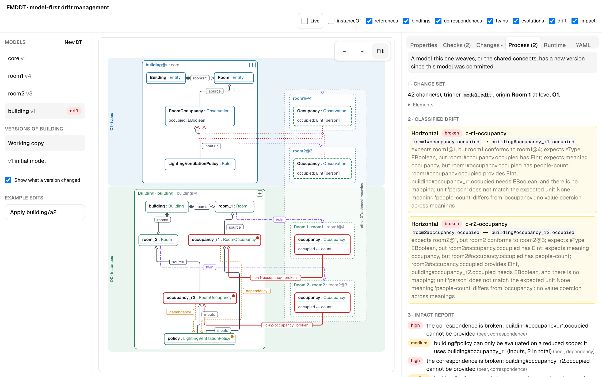

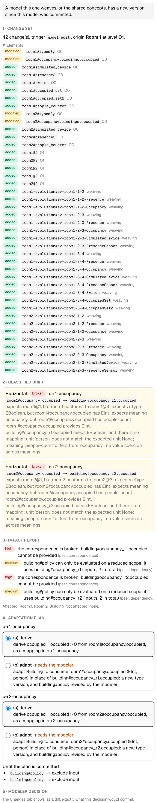

After accepting: `building` at version 2; both correspondences *holds*, each with the mapping `occupied > 0` on its line in the diagram; the *drift* mark is gone; *Checks* is green.

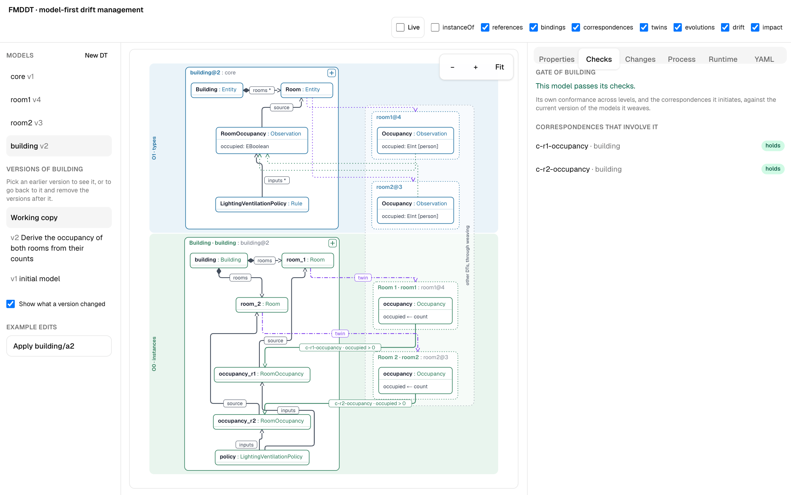

**Why.** The horizontal drift is resolved by the initiating DT, in its own model: the correspondence now says how the Boolean it needs is derived from the count the room offers. The rooms are not touched. The mapping is explicit, admitted by a derivation of `core` (`people-count` → `occupancy`): there is no value coercion across meanings.

## To know

- **Model in focus** is the model whose *Process* tab shows the step. A plan for another model is a proposal for its modeler.
- Until a plan is committed, what depends on a drifted input excludes it (`exclude_input`), and a reaction that cannot be evaluated is suspended.
- In steps 4a, 4b and 5b the *Process* of the room lists only a change request ("restore…") for the correspondence; in step 6 the *Process* of Building offers derive and adapt for the same drift.
- The simulated parts are those of the catalogue of the `simulated` connector: a presence sensor, a switch, a people counter. They report the value they are configured with (`value`, in their Properties).
